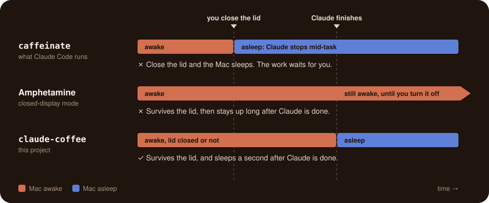
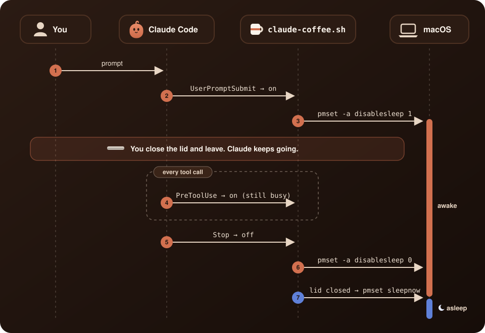

<p align="center">
  
</p>

<p align="center">
  <a href="https://github.com/ivaruf/claude-coffee/actions/workflows/ci.yml"></a>
  
  
  <a href="https://code.claude.com/docs/en/hooks"></a>
  <a href="LICENSE"></a>
</p>

<p align="center">
  <b>Close the lid. Claude keeps working. The Mac sleeps the moment it's done.</b>
</p>

<p align="center">
  <a href="#quick-start">Quick start</a> ·
  <a href="#why-claude-coffee">Why</a> ·
  <a href="#how-it-works">How it works</a> ·
  <a href="#guards">Guards</a> ·
  <a href="#configuration">Configuration</a> ·
  <a href="docs/verification.md">Field notes</a>
</p>

---

Close the lid mid-task and macOS puts the Mac to sleep, freezing Claude's work. **claude-coffee keeps the Mac awake, lid closed included, exactly while a Claude Code session is working, and lets it sleep the moment the last one finishes.** The rest of the time your Mac sleeps as usual, so you keep the battery life Apple silicon is known for.

## Quick start

```sh
curl -fsSL https://raw.githubusercontent.com/ivaruf/claude-coffee/main/install.sh | sh
```

Or read it first: `git clone https://github.com/ivaruf/claude-coffee && cd claude-coffee && ./install.sh`. The installer may ask for your password once. Running sessions pick it up on their next turn, and running it again updates it. To see what it's doing: `~/.claude/hooks/claude-coffee.sh status`.

<details>
<summary><b>What the installer changes</b></summary>

| What | Where |
|---|---|
| The hook script | `~/.claude/hooks/claude-coffee.sh` |
| Five hook groups next to your own (a backup is kept) | `~/.claude/settings.json` |
| Passwordless `pmset -a disablesleep 0` and `1`, checked with `visudo` | `/etc/sudoers.d/claude-coffee` |
| A launch agent that re-checks every minute | `~/Library/LaunchAgents/com.github.ivaruf.claude-coffee.plist` |

macOS then reports that *claude-coffee.sh can run in the background*: that's the launch agent. Requires `jq`, built into recent macOS (otherwise `brew install jq`).

</details>

<p align="center">
  
</p>

## Why claude-coffee

`caffeinate` lets the Mac sleep again, but not with the lid closed. Amphetamine keeps a closed Mac awake, but until you turn it off. **With claude-coffee you can close the lid, *and* your Mac still gets to sleep.**

<p align="center">
  
</p>

<p align="center">
  
  
</p>

| | Close the lid mid-task | Sleeps again by itself | Knows when Claude is working |
|---|:---:|:---:|:---:|
| `caffeinate` (Claude Code already runs it) | ✗ | ✓ | ✓ |
| Amphetamine, closed-display mode | ✓ | ✗ when you end it, or on a timer | ✗ |
| `sudo pmset -a disablesleep 1` by hand | ✓ | ✗ when you remember | ✗ |
| **claude-coffee** | ✓ | ✓ a second after the last turn | ✓ |

## Features

- **Lid closed, on battery, many sessions**: awake while any Claude Code session is mid-turn
- **Sleeps when done**: no toggle or timer; a lid closed mid-turn sleeps a second after the last turn ends
- **Easy on the battery**: awake only while Claude works, no app or daemon, just a check once a minute, and a battery guard at 20%
- **Long jobs**: a long tool call or a busy background build keeps the Mac up, for up to 4 hours; an idle dev server doesn't
- **Remote mode**: logged in over SSH, say from your phone, the Mac also stays up between turns
- **Heat and battery guards**: too hot with the lid closed, or low on battery, and it sleeps anyway
- **Can't get stuck awake**: markers expire, and a launch agent re-checks every minute
- **Least privilege**: sudo may run exactly two commands; without that rule the Mac just sleeps as usual
- **Silent**: the hooks print nothing, so nothing reaches Claude's context
- **Tested**: CI runs the hook and the installer against fakes, never your real settings

## How it works

<p align="center">
  
</p>

1. Hooks keep one marker file per busy session. `UserPromptSubmit` and `PreToolUse` create it; `Stop`, `StopFailure` and `SessionEnd` remove it, unless background tasks are still running.
2. Any marker means `pmset -a disablesleep 1`, the one switch that holds with the lid closed. No marker means `0`.
3. macOS decides on lid sleep only when the lid closes. So if it closed mid-turn, `pmset sleepnow` follows a second after the last turn ends.
4. Esc never fires `Stop`, so a marker that no hook has touched for 30 minutes expires. It stays, for up to 4 hours, while Claude Code is visibly still at work: its own `caffeinate` is running (a long tool call), or processes it started are using CPU or starting new ones (a background build). An idle dev server shows neither.
5. The [guards](#guards) override everything above.

Each rule is there because something needed it. The [field notes](docs/verification.md) record what was checked on a real Mac, including three bugs only the hardware revealed.

## Guards

<p align="center">
  
  
</p>

| Guard | Trips when | Why that limit | Clears when |
|---|---|---|---|
| Heat | The lid is closed and macOS's thermal state is *serious*, or the battery reaches 45 °C | *Serious* means fans at full speed; it's where Apple tells apps to cut back. 45 °C is the top of lithium-ion's charging range and Apple's highest storage temperature | You open the lid |
| Battery | On battery at 20% or less | macOS starts warning at about 10%, and with sleep switched off it may not get to sleep by itself | You plug in |

When a guard trips, claude-coffee stops keeping the Mac awake, even mid-turn. With the lid closed it sleeps right away, and a notification says why. Neither reading needs root, and `status` shows both. Sources are in the [field notes](docs/verification.md#heat-guard).

## Remote mode

Driving Claude Code from your phone over SSH? While you're logged in, the Mac also stays up between turns, so it doesn't fall asleep while you type the next prompt. It lapses after an hour without activity.

<details>
<summary>Tips for a phone setup</summary>

- Run `claude` inside `tmux` or `screen` (built into macOS), so the session survives a dropped connection. Reattach with `screen -dr`.
- The Mac has to be awake when you connect. Remote mode keeps it up; it doesn't wake it.
- Use key login: put your phone's public key in `~/.ssh/authorized_keys` and turn off password login.

</details>

## Configuration

Optional, in `~/.claude/coffee/config`:

```sh
STALE_MINUTES=30   # a marker no hook has touched for this long expires ...
MAX_QUIET_HOURS=4  # ... or this long while Claude Code is still at work (a long tool call, a busy build)
REMOTE=1           # 0 turns remote mode off
REMOTE_MINUTES=60  # how long remote mode lasts after the last activity
HEAT_GUARD=1       # 0 turns the heat guard off
HOT_BATTERY_C=45   # with the lid closed, a battery this hot (°C) means sleep
LOW_BATTERY=20     # on battery at this charge (%) or less, stop keeping the Mac awake; 0 turns it off
```

## Troubleshooting

`~/.claude/hooks/claude-coffee.sh status` shows what claude-coffee sees right now:

```console
claude-coffee
  sleep          blocked                    # kept awake right now ("allowed" otherwise)
  busy sessions  2                          # Claude Code sessions that are mid-turn
  remote mode    off (no SSH login)         # on while you're logged in over SSH
  lid            closed
  heat           battery 31 °C, thermal state nominal
  heat guard     armed: …                   # "tripped", with when and why, after it stepped in
  power          on battery, 64%
  battery guard  armed: …                   # same
  sudo pmset     ok                         # "missing": run the installer again
  launch agent   ok                         # "missing": run the installer again
```

- **The Mac slept while Claude was working?** Both last lines should say `ok`, and neither guard should say `tripped`.
- **The Mac won't sleep?** `busy sessions` and `remote mode` show what's holding it. A session interrupted with Esc lets go within about 30 minutes.
- **Still puzzled?** The kernel logs every sleep decision:

  ```sh
  log show --last 1h --style compact --predicate 'process == "kernel" AND eventMessage CONTAINS "PMRD"' \
    | grep -E 'prevented|sleep reason|Clamshell closed'
  ```

  `System sleep prevented by kPMUserDisabledAllSleep` means claude-coffee kept the Mac awake, and `kPMCPUAssertion` means another app did.

## Known limits

- Background work that looks idle, such as waiting on a download or a remote job, counts as finished after 30 minutes, just like an idle dev server. For a job like that, have Claude wait for it within the turn.
- A permission prompt left unanswered for more than 30 minutes counts as finished.
- After Esc, the Mac may stay up for about 31 minutes. That assumes Claude Code stops its `caffeinate` on Esc, which is untested.
- Neither guard has met a real bag or a real 20% yet. A fanless MacBook Air working hard with the lid closed may trip the heat guard on a desk.
- Tested with the CLI on macOS 26, Apple silicon. Editors that load `~/.claude/settings.json`, Intel Macs and older macOS versions should work; [reports welcome](https://github.com/ivaruf/claude-coffee/issues/new/choose).

## Uninstall

```sh
curl -fsSL https://raw.githubusercontent.com/ivaruf/claude-coffee/main/uninstall.sh | sh
```

Or `./uninstall.sh` from a clone. It removes everything in an order that never leaves sleep switched off, and checks that sleep is back on.

## Brewed with Claude

claude-coffee started as a question typed into the Claude app on a phone. A few rounds in that chat sketched the design. Then Claude Code built it on a real Mac, tested it with the lid closed, and recorded every assumption it checked in the [field notes](docs/verification.md).

---

[Contributing](CONTRIBUTING.md) (`make test` never touches your real settings) · [MIT license](LICENSE) · Not affiliated with Anthropic. Claude is a trademark of Anthropic.
