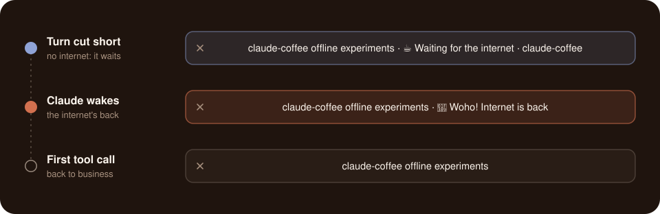

<p align="center">
  
</p>

<p align="center">
  <a href="https://github.com/ivaruf/claude-coffee/actions/workflows/ci.yml"></a>
  
  
  
  <a href="https://code.claude.com/docs/en/hooks"></a>
  <a href="LICENSE"></a>
</p>

<p align="center">
  <b>Close the lid. Claude keeps working. Your machine sleeps the moment it's done.</b>
</p>

<p align="center">
  <a href="#quick-start">Quick start</a> ·
  <a href="#why-claude-coffee">Why</a> ·
  <a href="#lost-the-internet">Lost the internet</a> ·
  <a href="#how-it-works">How it works</a> ·
  <a href="#guards">Guards</a> ·
  <a href="#linux-and-windows-beta">Linux &amp; Windows</a> ·
  <a href="#configuration">Configuration</a> ·
  <a href="docs/verification.md">Field notes</a>
</p>

---

Close the lid mid-task and your laptop goes to sleep, freezing Claude's work. **claude-coffee keeps it awake, lid closed included, exactly while a Claude Code session is working, and lets it sleep the moment the last one finishes.** The rest of the time it sleeps as usual, so you keep your battery life.

## Quick start

```sh
curl -fsSL https://raw.githubusercontent.com/ivaruf/claude-coffee/main/install.sh | sh
```

On Windows, run it in Git Bash. Or read it first: `git clone https://github.com/ivaruf/claude-coffee && cd claude-coffee && ./install.sh`. On a Mac, the installer may ask for your password once. Running sessions pick it up on their next turn, and running it again updates it. To see what it's doing: `~/.claude/hooks/claude-coffee.sh status`.

<details>
<summary><b>What the installer changes</b></summary>

| What | Where |
|---|---|
| The hook script | `~/.claude/hooks/claude-coffee.sh` |
| Five hook groups next to your own (a backup is kept) | `~/.claude/settings.json` |
| macOS: passwordless `pmset -a disablesleep 0` and `1`, checked with `visudo` | `/etc/sudoers.d/claude-coffee` |
| macOS: a launch agent that re-checks every minute, and at login | `~/Library/LaunchAgents/com.github.ivaruf.claude-coffee.plist` |
| Linux: a systemd user timer that re-checks every minute | `~/.config/systemd/user/claude-coffee.timer` and `.service` |
| Windows: a scheduled task that re-checks every minute while you're logged on | Task Scheduler: `claude-coffee` |

macOS then reports that *claude-coffee.sh can run in the background*: that's the launch agent. Requires `jq`, built into recent macOS (otherwise `brew install jq`).

</details>

<p align="center">
  
</p>

## Why claude-coffee

On a Mac, `caffeinate` lets it sleep again, but not with the lid closed. Amphetamine keeps a closed Mac awake, but until you turn it off. **With claude-coffee you can close the lid, *and* your machine still gets to sleep.** And if the internet drops mid-task, it waits for it, then has Claude [carry on](#lost-the-internet).

<p align="center">
  
</p>

<p align="center">
  
  
</p>

<p align="center">
  
</p>

## Lost the internet?

<p align="center">
  
</p>

When the internet drops mid-turn, Claude Code retries for a few minutes, then ends the turn with an error such as `API Error: Can't reach the API server`. claude-coffee doesn't let go then. It keeps the machine awake and checks every 20 seconds whether the API answers. The moment it does, it wakes Claude, which carries on where it stopped. A notification says when it's gone and when it's back, and so does the terminal's title:

<p align="center">
  
</p>

`status` shows how long it's been, with little Claude's worries:

```console
  auto-continue  waiting for the internet: gone 12 min, gives up in 48 min
                 little Claude (o_o;) "This task is far too complex for me. I'm a shell script."
```

After an hour without internet, three tries in a row that fail before a single tool call, or a guard stepping in, it gives up and lets the machine sleep; reply `continue` when you're back. A prompt you type meanwhile takes over. A rate limit or any other API error ends the turn as usual. The [field notes](docs/verification.md#losing-the-network) have the tests, including a real Wi-Fi drop.

## Features

- **Lid closed, on battery, many sessions**: awake while any Claude Code session is mid-turn
- **Sleeps when done**: no toggle or timer; a lid closed mid-turn sleeps a few seconds after the last turn ends
- **Carries on after a lost connection**: the internet drops mid-turn, and it stays up, waits for it, then wakes Claude to [carry on](#lost-the-internet)
- **Easy on the battery**: awake only while Claude works (lid closed while it waits: [1.5 W](docs/verification.md#power-draw) on an M4 Pro), no app or daemon, just a check once a minute, and a battery guard at 20%
- **Long jobs**: a long tool call or a busy background build keeps the machine up, for up to 4 hours; an idle dev server doesn't
- **Remote mode**: logged in over SSH, say from your phone, the machine also stays up between turns
- **Heat and battery guards**: too hot with the lid closed, or low on battery, and it sleeps anyway
- **Can't get stuck awake**: markers expire, and a check runs every minute
- **Least privilege**: no root or admin on Linux and Windows; on macOS, sudo may run exactly two commands, and without that rule the Mac just sleeps as usual
- **Silent**: the hooks print nothing, so nothing reaches Claude's context, apart from the one line that wakes it after a lost connection
- **Tested**: CI runs the hook and the installer against fakes, never your real settings

## How it works

<p align="center">
  
</p>

1. Hooks keep one marker file per busy session. `UserPromptSubmit` and `PreToolUse` create it; `Stop`, `StopFailure` and `SessionEnd` remove it, unless background tasks are still running or the internet cut the turn short.
2. On macOS, any marker means `pmset -a disablesleep 1`, the one switch that holds with the lid closed. No marker means `0`. Linux and Windows have [their own switches](#linux-and-windows-beta).
3. macOS decides on lid sleep only when the lid closes. So if it closed mid-turn, `pmset sleepnow` follows a few seconds after the last turn ends.
4. Esc never fires `Stop`, so a marker that no hook has touched for 30 minutes expires. It stays, for up to 4 hours, while Claude Code is visibly still at work: its own `caffeinate` is running (a long tool call), or processes it started are using CPU or starting new ones (a background build). An idle dev server shows neither.
5. A turn the internet cut short also starts a background `StopFailure` hook (`asyncRewake`). It keeps the marker fresh and waits for the API to answer, then exits 2, which wakes Claude: a new turn, [carrying on](#lost-the-internet).
6. The [guards](#guards) override everything above.

Each rule is there because something needed it. The [field notes](docs/verification.md) record what was checked on a real Mac, including three bugs only the hardware revealed.

## Guards

<p align="center">
  
  
</p>

| Guard | Trips when | Why that limit | Clears when |
|---|---|---|---|
| Heat | The lid is closed and macOS's thermal state is *serious*, or the battery reaches 45 °C | *Serious* means fans at full speed; it's where Apple tells apps to cut back. 45 °C is the top of lithium-ion's charging range and Apple's highest storage temperature | You open the lid |
| Battery | On battery at 20% or less | macOS starts warning at about 10%, and while sleep is switched off it refuses its own low-battery sleep | You plug in |

While sleep is switched off, macOS also turns down its own low-battery and overheating sleep, so these guards stand in for them. When a guard trips, claude-coffee stops keeping the machine awake, even mid-turn. With the lid closed it sleeps right away, and a notification says why. Neither reading needs root, and `status` shows both. Sources are in the [field notes](docs/verification.md#heat-guard).

## Linux and Windows (beta)

The same hooks and guards run on Linux and on Windows, each with its own way of holding the machine awake. Both are tested in CI against faked system commands, but neither has run on real hardware yet, so [reports are welcome](https://github.com/ivaruf/claude-coffee/issues/new/choose).

| | Keeps it awake with | Checks every minute with | Needs |
|---|---|---|---|
| macOS | `pmset disablesleep`, through a two-command sudo rule | a launch agent | `jq` |
| Linux | a logind lock on sleep and the lid switch, held by a small user service; no root | a systemd user timer | systemd, `jq`, a local desktop session |
| Windows | the power plan's lid action and sleep timeout, set to "do nothing" and "never" while Claude works, then put back; no admin | a scheduled task | Git for Windows (Claude Code's Git Bash), `jq` |

- **Linux:** KDE Plasma and Xfce handle the lid themselves, so lid-closed mode doesn't work there; the installer warns. From an SSH login alone, polkit refuses the lid lock. When the lock goes with the lid closed, logind puts the computer to sleep by itself. On GNOME the lock also holds off GNOME's own automatic suspend. With systemd 257 or later, suspending by hand waits until Claude is done, as on macOS.
- **Windows:** the plan change is machine-wide while it lasts, and Group Policy can block it (the installer warns). After a restart mid-turn, the plan is put back within 30 minutes of logging in. Reading the lid takes PowerShell, so the hooks use the minute check's readings and only ask again when a turn ends. Heat readings are thin on most laptops. WSL isn't supported yet.

The [field notes](docs/verification.md#linux) list what each backend relies on and what's still unverified.

## Remote mode

Driving Claude Code from your phone over SSH? While you're logged in, the machine also stays up between turns, so it doesn't fall asleep while you type the next prompt. It lapses after an hour without activity.

<details>
<summary>Tips for a phone setup</summary>

- Run `claude` inside `tmux` or `screen` (built into macOS), so the session survives a dropped connection. Reattach with `screen -dr`.
- The machine has to be awake when you connect. Remote mode keeps it up; it doesn't wake it.
- Use key login: put your phone's public key in `~/.ssh/authorized_keys` and turn off password login.

</details>

## Configuration

Optional, in `~/.claude/coffee/config`:

```sh
STALE_MINUTES=30   # a marker no hook has touched for this long expires ...
MAX_QUIET_HOURS=4  # ... or this long while Claude Code is still at work (a long tool call, a busy build)
REMOTE=1           # 0 turns remote mode off
REMOTE_MINUTES=60  # how long remote mode lasts after the last activity
HEAT_GUARD=1       # 0 turns the heat guard off
HOT_BATTERY_C=45   # with the lid closed, a battery this hot (°C) means sleep
LOW_BATTERY=20     # on battery at this charge (%) or less, stop keeping the machine awake; 0 turns it off
AUTO_CONTINUE=1    # 0: a turn the internet cut short waits for you to reply "continue"
OFFLINE_MINUTES=60 # how long to stay awake waiting for the internet (at most 239)
```

## Troubleshooting

`~/.claude/hooks/claude-coffee.sh status` shows what claude-coffee sees right now:

```console
claude-coffee
  sleep          blocked                    # kept awake right now ("allowed" otherwise)
  busy sessions  2                          # Claude Code sessions that are mid-turn
  remote mode    off (no SSH login)         # on while you're logged in over SSH
  auto-continue  on: …                      # "waiting for the internet" after a lost connection
  lid            closed
  heat           battery 31 °C, thermal state nominal
  heat guard     armed: …                   # "tripped", with when and why, after it stepped in
  power          on battery, 64%
  battery guard  armed: …                   # same
  sudo pmset     ok                         # "missing": run the installer again
  launch agent   ok                         # "missing": run the installer again
```

- **Your machine slept while Claude was working?** Both last lines should say `ok`, and neither guard should say `tripped`.
- **Your machine won't sleep?** `busy sessions` and `remote mode` show what's holding it. A session interrupted with Esc lets go within about 30 minutes.
- **Still puzzled, on a Mac?** The kernel logs every sleep decision:

  ```sh
  log show --last 1h --style compact --predicate 'process == "kernel" AND eventMessage CONTAINS "PMRD"' \
    | grep -E 'prevented|sleep reason|Clamshell closed'
  ```

  `System sleep prevented by kPMUserDisabledAllSleep` means claude-coffee kept the Mac awake, and `kPMCPUAssertion` means another app did.

## Known limits

- Background work that looks idle, such as waiting on a download or a remote job, counts as finished after 30 minutes, just like an idle dev server. For a job like that, have Claude wait for it within the turn.
- A permission prompt left unanswered counts as finished after 30 minutes. If Claude Code keeps its `caffeinate` running while it waits (untested), that becomes up to 4 hours.
- Auto-continue knows a lost connection by Claude Code's error message (its error type only says `server_error`), so a new wording in a later Claude Code would end the turn as before. It checks for the internet by reaching `api.anthropic.com`, or `ANTHROPIC_BASE_URL`. It has carried on after one real Wi-Fi drop with the interactive CLI; the [field notes](docs/verification.md#a-real-drop) have that and the other tests.
- If a Mac restarts mid-turn, sleep stays switched off until you log in; the check then lets go right away.
- After a guard puts a Mac to sleep mid-turn, Claude Code may retry its request during macOS's brief maintenance wakes, which uses quota ([reported for another tool](https://dev.to/dawonlee/lid-closed-claude-code-still-running-how-macos-darkwakes-burn-your-weekly-limit-overnight-217i)).
- After Esc, the machine may stay up for about 31 minutes. That assumes Claude Code stops its `caffeinate` on Esc, which is untested.
- Neither guard has met a real bag or a real 20% yet. A fanless MacBook Air working hard with the lid closed may trip the heat guard on a desk.
- Tested with the CLI on macOS 26, Apple silicon. Editors that load `~/.claude/settings.json`, Intel Macs and older macOS versions should work; [reports welcome](https://github.com/ivaruf/claude-coffee/issues/new/choose). Linux and Windows haven't run on real hardware yet: see [Linux and Windows](#linux-and-windows-beta).

## Uninstall

```sh
curl -fsSL https://raw.githubusercontent.com/ivaruf/claude-coffee/main/uninstall.sh | sh
```

Or `./uninstall.sh` from a clone. It removes everything in an order that never leaves sleep switched off, and checks that sleep is back on.

## Brewed with Claude

claude-coffee started as a question typed into the Claude app on a phone. A few rounds in that chat sketched the design. Then Claude Code built it on a real Mac, tested it with the lid closed, and recorded every assumption it checked in the [field notes](docs/verification.md).

---

[Contributing](CONTRIBUTING.md) (`make test` never touches your real settings) · [MIT license](LICENSE) · Not affiliated with Anthropic. Claude is a trademark of Anthropic.
